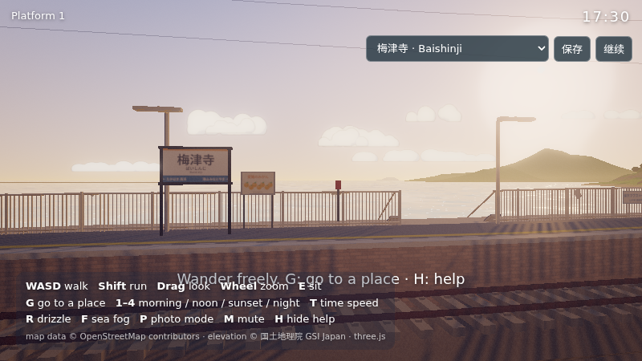
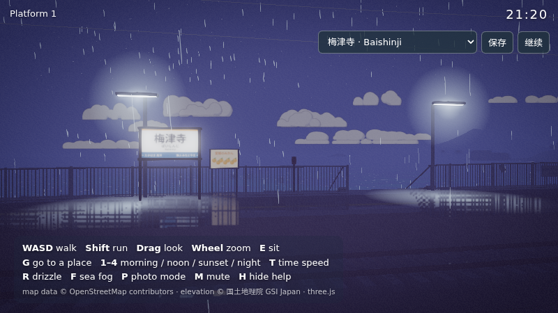
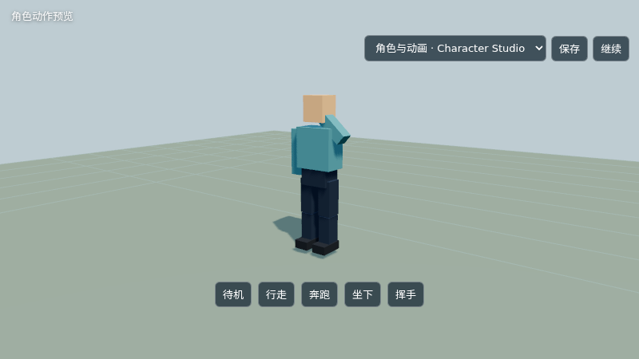

# v0.4 Harbor migration / Harbor 迁移验证

执行日期 / Date: 2026-10-21. 本节记录本次迁移，以下 v0.3 记录保留为历史基线。

- `npm test`: 22/22 passed. Includes independent actors, original saves/story/scene lifecycle, quality candidate cancellation and delayed GPU cleanup, readiness after source LOD changes, all-attempt failure cleanup, original geometry ownership, building LOD, exact authored room colour/emission, clock-style private geometry updates with untouched static BVHs, and DEM clipping around an island invisible to six triangle sample points.
- `npm run build`: typecheck, content validation and production build passed. Relative `base: './'`; root HTML is 4.14 KB. The official 7,698,439-byte OIDN large FP32 weight is a separate same-origin lazy asset, with license. A distribution check verifies its exact SHA-256/size, all required notices, content manifest assets, relative entry/module references and the platform HTML size limit.
- Original raster software browser regression passed with no JS/GPU/HTTP errors or warnings: all nine places, eleven story beats, original save/restore and three scene round trips. Explicit `view=raster` and SwiftShader identify this as compatibility/logic evidence, not GTX1070 performance proof.
- Full Baishinji CPU-only quality conversion and private Harbor compaction: 1,474 meshes, 60,894 instances, 4,658,630 expanded triangles; 1,389 unique prepared geometries, 7,893,563 compact vertices, 287,122,268 geometry bytes and 631,485,040 attribute bytes. Unsupported material list was empty. Actual upstream packing uses `position/normal/tangent/color/uv`, an 80-byte vertex stride and a 631,485,040-byte attribute binding; all five CPU storage arrays sum to 724,743,696 bytes. This is not total GPU memory use or a substitute for allocation testing.
- The actual upstream `PathtracerBVHComputeData.update()` CPU build then passed with 417 materials in 22.47 s after Harbor's ordered ≤128-group partitions and empty-LOD scaffolds. Prepared parts count is 1,504; source instances count is 60,896 because that inspection includes two empty, nonrendering scaffolds. It does not add game content. Expanded triangle count remains exactly 4,658,630. `npm run test:quality:cpu` fixes this real full-scene build as a preflight regression, served through Vite rather than the production static server.
- A fixed-build software Studio HDR smoke at an explicitly reduced 80×45 drawing buffer passed complete-frame/megakernel rendering with fifteen bounces, minimum 2 spp, finite nonzero raw HDR and no console errors. It verified the capture/composition path and corrected an undefined NodeMaterial position node; it is not hardware or full-scene acceptance.
- A production software Studio UI check at an explicitly reduced 160×90 buffer passed readiness, disabled raster refinement, actual Refine/Resume clicks and paused DOM progress updates. Clock/place refresh is read-only during rendering; a scope-owned UI timer reports asynchronous OIDN completion without advancing the frozen simulation.
- GTX1070 Baishinji at 1280×720, full drawing buffer and fifteen bounces passed a complete first frame, minimum 64 spp and same-GPU large FP32 OIDN. Against the same frozen camera's 256-spp raw reference, global MSE decreased from 0.00004755235 to 0.00003743029 (21.3%); centre-region MSE decreased 26.6%. These results do not complete the remaining location, lighting, animation and lifecycle acceptance. Platform updates remain pending.
- Initial full-scene live frames took approximately 0.8–1 second each on GTX1070. This quality configuration is not smooth interactive rendering; use explicit raster for play. The existing 0.1-second RAF simulation clamp is preserved, so gameplay can advance more slowly than wall time at this frame rate. Performance tuning is deferred.
- The first full-scene quality preparation took about 72 seconds, including CPU preparation and GPU compilation. Creating or removing lazy town LOD objects rebuilds the quality presentation and its private geometry/BVH cache; ordinary movement within existing LOD geometry does not. Further loading pauses at new LOD boundaries remain an experience limitation.
- The first two GTX1070 full-scene preparations reported explicit raster fallback: upstream seven-bit BVH root capacity and an empty-LOD material group lookup. Those failures were fixed before the successful complete-frame test and are not themselves quality passes. Nothing has been merged or published based on fallback results.

`tests/quality-browser.mjs` supports `TEST_GPU=hardware`, `TEST_SCENE=baishinji|studio`, `TEST_REFINE=1`, `TEST_WIDTH/TEST_HEIGHT`, `TEST_CDP`, `TEST_HEADED` and `CHROMIUM_PATH`. Software quality checks use a smaller explicitly labelled functional viewport. No software result is reported as hardware validation.

# v0.3 迁移验证（历史 / Historical）

执行日期：2026-10-18。基线为原仓库 `fdc41fb73abccef0ce900ef0627c2848f9412061`。

## 环境与方法

- Node.js 24.21.0，Python 3.14.6，Chromium 152.0.7977.82，800 × 450 视口。
- 临时隔离 Chromium 会话，SwiftShader 软件适配器。浏览器实际进入 WebGPURenderer 的 WebGPU 后端；兼容检查显式使用 WebGL2。
- 浏览器验证针对 `npm run build` 产物，由本机静态预览服务提供，不依赖开发服务器 HMR。
- 不将软件渲染 FPS 作为目标桌面 GPU 或手机的性能结论。

## 已执行检查

| 检查 | 结果 |
|---|---|
| `npm test` | 9 项通过：作用域清理、共享资源并发 / 取消 / 晚到释放、场景切换失败与取消、空间查询、剧情跳过、存档验证、独立骨架与动作重播 |
| `npm run build` | TypeScript 核心严格检查、内容校验、生产构建通过 |
| 内容清单 | 2 个场景、资源引用、GLB 骨架与五动作、2 份地形网格、21 个建筑变体及三级 LOD 通过 |
| 原始数据对照 | 7 份 JSON 与旧版对应数据脚本中的对象逐项相等；geo 的坐标转换函数移到场景模块 |
| Python 工具 | 6 个文件通过 AST 语法检查；没有重新联网抓取或运行 Blender 烘焙 |
| WebGPU 生命周期 | 九个地点分别定位并渲染；梅津寺 ↔ 角色 Studio 往返三次；存档恢复为剧情模式 |
| 剧情流程 | 1156 次一秒模拟步进，依次经过全部 11 段并回到漫游；这是加速逻辑检查，不是人类完整观看验收 |
| 场景资源 | 三次返回均为 185 个已上传几何、354 个顶点属性（23,586,360 字节）、44 张纹理、7 个资源句柄、55 个监听 / 清理登记、2356 个碰撞框、19 个更新器 |
| WebGPU 高画质与阴影 | 执行结果见本文件末尾的渲染矩阵 |
| WebGL2 与子目录部署 | 执行结果见本文件末尾的渲染矩阵 |

生命周期测试初始梅津寺有 1478 个 mesh。迁移移除了七个没有实例的电线杆批次，并将密集栏杆拆成较小批次；mesh 数量本身不表示内容增减。上传几何计数只统计实际渲染过的资源，不等于所有 CPU 几何；视角、LOD、列车和剧情会改变计数。三次循环的稳定结果不能替代数小时内存曲线或 JS 堆分析。

测试也追踪顶点缓冲的数量和字节数；仅几何 / 贴图计数稳定不足以证明缓冲已释放。

测试中修复了生产压缩改变函数名导致检查点失效、共享 Sprite 几何被场景提前销毁、树冠 LOD 克隆未登记和距离中心不正确、对象渲染绑定未释放、超大栏杆实例批次的跨 pass 属性滞留、建筑窗灯字节标量顶点格式不兼容 WebGPU、空实例批次创建零字节 GPU 缓冲，单次动作重播时自我淡出，以及多重采样深度不能被 GTAO gather 读取的问题（改为单采样 G-buffer + SMAA）。

## 复现

```bash
npm ci
npm test
npm run build
npm run preview -- --port 5180
```

另开终端：

```bash
TEST_URL=http://127.0.0.1:5180/ npm run test:browser
TEST_URL=http://127.0.0.1:5180/ TEST_NAME=blocked-storage TEST_BLOCK_STORAGE=1 npm run test:browser
TEST_URL=http://127.0.0.1:5180/ TEST_NAME=webgpu-high TEST_QUERY='?still&start&at=platform1&fx=high' TEST_SCENE_CYCLE=3 npm run test:browser
```

子目录兼容测试先在另一个终端启动：

```bash
npm run preview -- --port 5181 --base /dragon-raja/
```

再执行：

```bash
TEST_URL=http://127.0.0.1:5181/dragon-raja/ TEST_NAME=webgl-low TEST_QUERY='?still&start&fx=low&renderer=webgl' TEST_SCENE_CYCLE=3 npm run test:browser
```

可用 `CHROMIUM_PATH` 指定可执行文件。脚本会记录 JS / GPU / HTTP 错误，输出截图和 JSON 到 `tests/artifacts/`。此目录不提交到 git；交付验证包另附结果。CI 工作流执行 npm ci、单元测试和构建；GitHub 已执行迁移版本的工作流，各次提交状态以对应检查为准。浏览器 GPU 检查是独立的本机步骤。

### 平台内嵌存储回归

Bilibili Toy 跨站内嵌预览曾在读取 `localStorage` 属性时抛出 `SecurityError`，导致启动中断。后续修复在属性访问、读写权限或配额失败时降级为页面内临时存档。新增两项单元测试后总计 11 项；`TEST_BLOCK_STORAGE=1` 可重现属性访问被拒绝，验证启动、临时保存提示、跨场景恢复及原有剧情流程。初始验证表和下方截图保留迁移基线，平台发布时的实际结果另附发布记录。

## 尚未验收的范围

- 真实硬件 GPU、Safari / Firefox、手机触控与性能预算。
- 完整人工游玩、音频听感、所有剧情镜头的画质对照。
- 各种第三方角色骨架、压缩纹理、超大模型；目前使用仓库自带原创占位 GLB。
- 重新生成地图和完整 Blender AO 烘焙、无缝区域流式加载、长时间内存曲线。

## 渲染矩阵与截图

- WebGPU，高档后期 + 阴影 + SMAA：白天、雨夜与角色场景往返三次通过，0 个 JS / GPU / HTTP 错误、0 个警告。
- 高档场景热身后连续三次均为：178 个已上传几何、297 个顶点属性、25,242,392 字节顶点属性、56 张纹理、21 个渲染目标、334 个 uniform buffer。首次进入不同渲染路径会建立渲染器级缓存；后续循环没有持续增长。程序源码字节数可能随内部 ID 长度略变。
- WebGL2，低档后期 + 阴影 + SMAA，在 `/dragon-raja/` 子目录：白天、雨夜与角色场景往返三次通过，0 个 JS / GPU / HTTP 错误。软件 OpenGL 驱动记录了两条 `outsideRenderPass queueSerial` 性能警告，不据此推断真实设备性能。
- WebGL2 三次返回均为：251 个已上传几何、448 个顶点属性（28,829,356 字节）、71 张纹理、19 个渲染目标、454 个 uniform buffer。不同后端的缓存及统计口径不完全一致，不能直接用这些数字判断后端优劣。

以下为 800 × 450 软件适配器截图，未经过外部图像增强：






